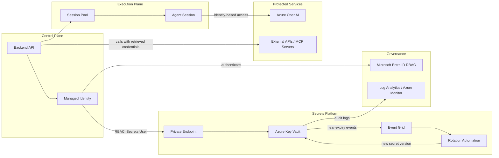

# ADR: Securing AI Agent Secrets, Keys, and Certificates with Azure Key Vault
---

## Executive Summary

AI agent platforms depend on many credentials: model endpoints, search services, enterprise APIs, MCP servers, databases, and certificates. Without a clear secrets strategy, these credentials spread across code, container images, environment variables, and pipelines, which increases the risk of leakage and makes rotation and auditing difficult.

This ADR decides that **Azure Key Vault is the single, central service for storing and governing secrets, keys, and certificates** in agent platforms, and that workloads access it exclusively through **Microsoft Entra ID managed identities** and **Azure RBAC**.

The guiding rule is: **eliminate secrets where possible, and centrally protect the ones that remain.**

## Context

The reference architecture separates the **Control Plane** (backend API, identity, governance) from the **Execution Plane** (Session Pool-hosted agents). It also requires Zero-Trust security: no implicit trust, least privilege, and no long-lived embedded credentials.

Agent workloads typically need to reach:

- Azure OpenAI
- Azure AI Search
- Azure Cosmos DB, Azure SQL Database, Azure Storage
- Internal enterprise APIs and SaaS platforms
- MCP servers and external tools
- Certificates for TLS, mutual TLS, or signing

Agents also process **untrusted prompts** and invoke tools, so any credential reachable from the execution environment can become a target (for example through prompt injection or tool abuse).

### Problems with unmanaged secrets

- Secrets in source code, container images, or configuration files can leak.
- Environment-variable secrets are visible to anyone with access to the runtime or its configuration.
- Manual rotation is error-prone and often skipped.
- There is no central audit trail of who accessed which secret and when.
- Long-lived shared credentials increase the blast radius of a compromise.

---

## Decision

We will use **Azure Key Vault** as the authoritative store for all secrets, cryptographic keys, and certificates used by agent platforms, following the rules below.

### Decision 1: Prefer identity over secrets

Wherever an Azure service supports Microsoft Entra ID authentication, workloads authenticate with **managed identities** and Azure RBAC, so no secret exists at all. Key Vault is used for the credentials that cannot be replaced by identity, such as third-party API keys, tokens for external tools and MCP servers, and certificates.

### Decision 2: Access through managed identities only

- Workloads reach Key Vault using **system-assigned or user-assigned managed identities**.
- No Key Vault credentials, client secrets, or connection strings are stored in code, images, or pipelines.
- Each workload gets its **own identity**, to keep ownership and audit boundaries clear.

### Decision 3: Authorize with Azure RBAC and least privilege

- Use the **Azure RBAC** permission model for Key Vault instead of legacy access policies.
- Grant the narrowest built-in role at the narrowest scope (vault or individual secret), for example:

| Consumer | Recommended Role | Purpose |
|----------|------------------|---------|
| Application / backend reading secrets | Key Vault Secrets User | Read secret values only |
| Workloads using keys for crypto operations | Key Vault Crypto User | Use keys without exporting them |
| Automation managing secret lifecycle | Key Vault Secrets Officer | Create, update, rotate secrets |
| Platform administrators | Key Vault Administrator (restricted, time-bound) | Vault management |

- Human access to production vaults should be exceptional, time-bound (for example via Privileged Identity Management), and audited.

### Decision 4: Keep secrets in the control plane

Consistent with the Session Pools architecture:

- The **backend (control plane)** retrieves and holds secrets, and performs authenticated calls to sensitive systems on behalf of agents where practical.
- **Session containers (execution plane)** must not receive broad vault access. Where a session needs a credential, it receives only a **scoped, short-lived** credential, or uses a tightly scoped managed identity where supported.
- Credentials must **never be generated or persisted inside sessions**, since sessions are ephemeral and not trusted.

### Decision 5: Isolate vaults by environment and sensitivity

- Use **separate vaults per environment** (development, test, production).
- Consider separate vaults for different workloads or sensitivity levels so that a single RBAC mistake cannot expose everything.

### Decision 6: Protect against loss and deletion

- Keep **soft delete** enabled and enable **purge protection** on production vaults.
- Note that purge protection cannot be turned off once enabled, so confirm the retention period before enabling it.

### Decision 7: Restrict the network path

- Use **Private Endpoints** (Azure Private Link) and disable public network access for production vaults.
- Configure private DNS so workloads resolve the vault to its private address.
- Where public access is unavoidable (for example in development), restrict it with firewall rules.

### Decision 8: Rotate and expire secrets

- Define **expiration dates** and a **rotation policy** for every secret, key, and certificate.
- Use Key Vault's automated rotation for keys and certificates where available.
- For secrets, automate rotation by reacting to Key Vault events with automation such as Azure Functions.
- Design applications to **reload secrets** without redeployment, and to tolerate version changes.

### Decision 9: Audit and monitor

- Send Key Vault diagnostic logs (audit events) to a **Log Analytics workspace**.
- Alert on anomalies such as unexpected callers, access from unfamiliar networks, high failure rates, and bulk reads.
- Include Key Vault health and throttling in the platform's observability dashboards.

### Decision 10: Plan for throttling and availability

- Key Vault enforces per-vault request limits, so **cache secrets in memory** for a bounded time instead of reading them on every request.
- Implement retries with backoff and handle temporary unavailability gracefully.

---

## Reference Architecture

---

## Alternatives Considered

| Alternative | Advantages | Reasons Not Chosen |
|-------------|------------|--------------------|
| **Environment variables / app settings** | Simple | Visible to anyone with runtime or configuration access, no central rotation, weak audit trail |
| **Container Apps secrets only** | Built in, easy | Scoped per app, not a central governance point, limited rotation and audit capabilities. Best used as a reference to Key Vault rather than a replacement |
| **Kubernetes Secrets** | Familiar to Kubernetes teams | Only base64 encoded by default, weaker central auditing, not applicable to all Azure services in this architecture |
| **HashiCorp Vault** | Powerful, cloud-agnostic | Additional infrastructure to operate and secure, less native integration with Azure identity and services |
| **CI/CD pipeline secrets (for example GitHub Secrets)** | Good for build-time use | Intended for pipelines, not runtime workloads |
| **Access policies instead of RBAC** | Legacy model | RBAC provides consistent Azure-wide authorization, finer scope, and better governance |

---

## Consequences

### Positive

- Centralized control and a single audit trail for sensitive material.
- No credentials in code, images, or pipelines.
- Smaller blast radius through per-environment vaults and least-privilege roles.
- Rotation and expiry become systematic.
- Aligns with Zero-Trust and with the control-plane / execution-plane separation.

### Negative / Trade-offs

- Adds a runtime dependency on Key Vault availability and latency.
- Additional cost (operations, private endpoints, and premium features if used).
- More setup complexity (RBAC, private networking, DNS).
- Teams must implement caching, retry, and secret-reload logic.

### Risks and Mitigations

| Risk | Mitigation |
|------|-----------|
| Key Vault throttling or temporary outage | In-memory caching, retries with backoff, graceful degradation |
| RBAC misconfiguration exposing secrets | Infrastructure as Code, policy checks, periodic access reviews |
| Secret retrieved by a compromised agent session | Keep secrets in the control plane, scoped short-lived credentials, outbound network restrictions |
| Accidental deletion | Soft delete and purge protection |
| Expired secret causing an outage | Expiry alerts through Event Grid, automated rotation, monitoring |

---

## Implementation Guidance

### Pilot Phase

| Setting | Value |
|---------|-------|
| Vaults | One per environment |
| Authorization | Azure RBAC |
| Identity | Managed Identity for every workload |
| Soft Delete | Enabled |
| Purge Protection | Enabled for production |
| Network | Private Endpoint for production |
| Monitoring | Diagnostic logs to Log Analytics |

### Production Phase

- Enforce the standards through **Azure Policy** (for example require RBAC, purge protection, private access, and diagnostics).
- Define rotation schedules and expiry alerts for all secrets.
- Review access periodically and remove unused permissions.
- Track Key Vault metrics (request rate, latency, throttling, failures) alongside agent platform telemetry.

### Anti-Patterns to Avoid

- Storing secrets in environment variables when Key Vault or identity-based access is possible.
- Sharing one vault and one identity across all environments.
- Granting `Key Vault Administrator` to applications.
- Reading secrets on every request without caching.
- Allowing agent sessions to read arbitrary vault contents.
- Logging secret values.

---

## Compliance and Security Notes

This decision supports Zero-Trust principles:

- **Verify explicitly:** every access is authenticated through Entra ID.
- **Use least privilege:** narrowly scoped RBAC roles.
- **Assume breach:** short-lived credentials, isolation, auditing, and rotation limit the impact of a compromise.

---

## Key Takeaways

Prefer managed identity over secrets wherever the service supports it.

Use Azure Key Vault as the single source of truth for remaining secrets, keys, and certificates.

Authorize with Azure RBAC and least-privilege roles.

Keep secrets in the control plane. Never trust or persist credentials inside agent sessions.

Separate vaults by environment and enable soft delete and purge protection.

Restrict access with Private Endpoints and audit everything with diagnostic logs.

Rotate secrets, cache them safely, and plan for throttling and availability.
