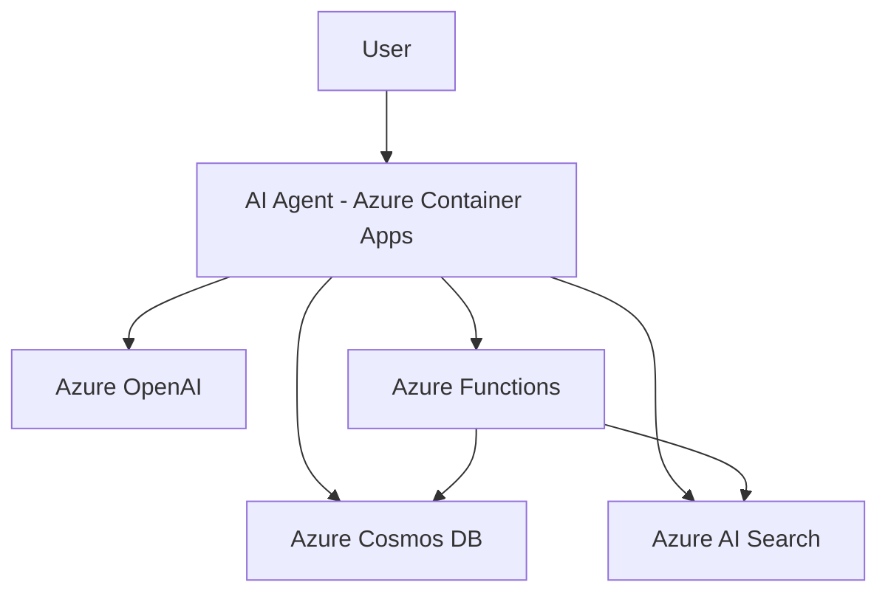

# Agent memory architecture on Azure

The agent needs access to earlier conversations, but sending the complete conversation history to the model on every request is not practical. I would keep recent messages separate from information that is worth remembering across sessions.

The proposed design uses Cosmos DB as the main store for conversations and memory records. Azure AI Search is a separate index used to retrieve relevant memories. The agent runs in Azure Container Apps and uses Azure OpenAI for generating responses, summaries and text embeddings. A small background process handles the longer-term memory updates.

## Architecture

*Figure 1. Request path and background memory updates.*

The agent reads conversations from Cosmos DB and searches long-term memory through Azure AI Search. Updates are handled in the background after a response. Entra ID and managed identities protect access to the services.

## Memory types

**Conversation / working memory.** The latest turns in the active conversation. It helps the model understand follow-up questions. These are stored as ordered messages, with a session ID, role and timestamp.

**Episodic memory.** A summary of something that happened in a past conversation, including when it happened and where the information came from. Example: the user asked for a weekly project update last Friday.

**Semantic memory.** Facts or preferences that remain useful beyond one session. Example: the user normally wants short technical explanations. Each fact should keep its source and be updated when corrected.

**Procedural memory.** Instructions for how an agent should complete a recurring task. Example: the steps to follow when preparing a status report. These instructions should be versioned and approved rather than learned automatically from any user message.

## Storage and services

| Service | Purpose |
| --- | --- |
| Azure Container Apps | Runs the agent API. It can scale independently of memory processing. |
| Azure Cosmos DB for NoSQL | Stores messages, summaries and memory documents as JSON. It is the source of truth. |
| Azure AI Search | Searches memory text using keywords and embeddings, with user/tenant filtering. |
| Azure OpenAI | Provides the chat model, summarization and embeddings used in semantic search. |
| Azure Queue Storage + Azure Functions | Processes new memories and keeps the search index in sync after a response. |

A memory record in Cosmos DB would contain id, tenantId, userId, memoryType, text (or steps), sourceConversationId, createdAt, updatedAt, status and version. AI Search stores a searchable copy with the embedding and scope fields.

## Retrieval during a request

1. The backend identifies the user and tenant from the authenticated request, not from a user-provided prompt.

2. It reads the latest messages and, if available, a summary of the current conversation from Cosmos DB.

3. It embeds the new question and searches Azure AI Search using a hybrid keyword/vector query. The query filters results to the authenticated user or an approved shared scope.

4. The agent selects a small number of relevant memories, removes duplicates, and sends them with the recent dialogue to the chat model.

5. The new messages are written to Cosmos DB. The agent then queues an event for background memory processing.

## Memory lifecycle

Creating memory: conversation turns are saved immediately. An Azure Function can later extract a useful episode, preference or task instruction. It should not promote every chat message into long-term memory.

Updating and summarizing: the worker summarizes older conversations when needed and updates existing records when information changes. Records keep their source, update time and version, so an old preference is not treated as a second active fact.

Deleting: the application removes or deactivates the Cosmos DB record and removes its corresponding Azure AI Search document. Search indexing is asynchronous, so deletion needs retry handling and a way to verify completion. Cosmos DB TTL alone does not delete a matching search-index document.

## Multiple users, security and scaling

Each record should contain a tenant ID, user ID and scope. Cosmos DB partitioning should match the most common reads, typically by tenant/user for long-term memory and by conversation for message history. Azure AI Search queries must always use an authorization filter; a shared procedure needs an explicit shared scope.

Container Apps handles concurrent agent requests, while the queue and Azure Functions allow summarization and indexing to scale separately. Queue events need stable IDs, retries and idempotent processing, otherwise repeated events may create duplicate memories. Cosmos DB throughput and Azure AI Search replicas/partitions can be adjusted after observing real traffic.

Microsoft Entra ID can handle authentication, with managed identities for service-to-service access. Raw conversations should not be placed in monitoring logs. Track request latency, search latency, queue backlog, failed updates and pending deletions using Azure Monitor/Application Insights.

## Design decisions and limits

Using both Cosmos DB and AI Search adds cost and synchronization work, but it keeps durable records separate from the retrieval index. For a small proof of concept, Cosmos DB vector search could be considered to reduce services. Here, AI Search is selected because hybrid retrieval and filtering are central requirements.

The background path also means a new memory may not appear in search immediately. This is acceptable for conversational preferences, but deletion requires stricter handling. No concrete sizing or retention period is proposed because the issue does not provide traffic volume or privacy constraints.

